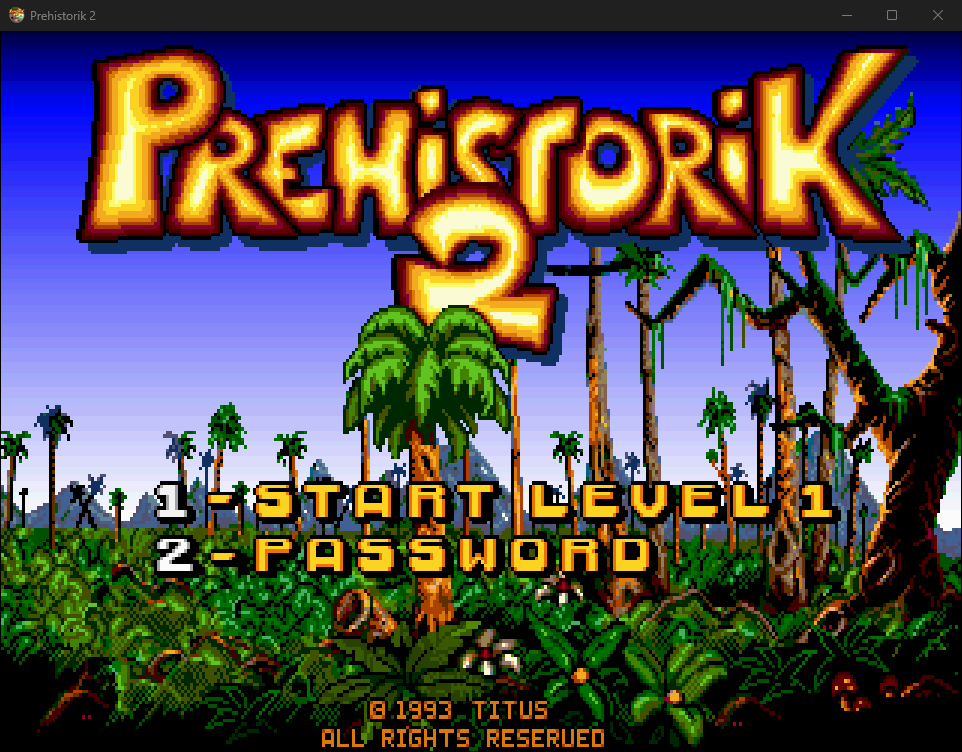

# Prehistorik 2 64bit (PreH2) — v1.1

A disassembly and static recompilation of the DOS game *Prehistorik 2* (Titus, 1993) into a
native 64-bit program. The Windows x64 build is done. The macOS build comes later.

The original game files are **not** included. You need your own copy of the DOS game: the
folder that holds `PRE2.SQZ` and its data files (in the CD version, the `PREH2` folder).



## Playing

1. Unpack the release zip anywhere.
2. Start `Prehistorik2.exe`. On the first run it looks for the game files in this order: the command
   line (`Prehistorik2.exe "D:\Games\PREH2"`), the saved setting, the exe's own folder or a `PREH2`
   folder next to it, and the current folder. If none of these has the files, a folder picker
   opens. The choice is saved in `%APPDATA%\PreH2\PreH2.ini`.

### Keys

The game's own keys work as on DOS: arrows to move, **Up** to jump, **Space** to strike,
**P** to pause, **Esc** to quit. **Keys…** in the system menu gives any of the game's actions
another key (saved in the `[Keys]` section of `PreH2.ini`).

| Host key | Action |
|---|---|
| Alt+Enter, F11 | full screen on/off |
| F5 | save the game's state into the chosen slot |
| F7 | load the state of the chosen slot |
| Tab (held) | fast forward: four times the speed, without sound |
| Pause | stop and continue the game |
| F12 | screenshot (PNG in `Pictures\Prehistorik 2`, in the shape of the picture on the screen) |
| Alt+Space | system menu |

Gamepads (XInput): d-pad or left stick → arrows, A → Up, B/X → Space, Y → keypad 5,
Start → Enter, Back → Esc, LB → F1, RB → P.

### Widescreen

**Display ▸ Widescreen** shows more of the level to the left and right of the original picture:
16:10 (384 pixels wide), 16:9 (428) or 21:9 (560) in place of 320. The game itself is not
changed: it plays exactly as with the original picture (same timing, same enemies, same random
numbers), and the extra columns are drawn by the game's own routines. Things to know:

- Enemies and objects wake up where the original game wakes them, so at the far edges they can
  appear or stop a little inside the picture.
- At the two ends of a level there is no more map to show, so the picture is as wide as the map
  allows and stays in the middle.
- The menus, the map and the other full-screen pictures stay 4:3, in the middle of the window.
- It works with the game version the port was made from. With another version the Widescreen
  entries are grey.

### Save states

**Save state** (F5) and **Load state** (F7) keep the whole machine, so a state continues at the
exact frame where it was saved. There are four slots (**State slot ▸**); the files are
`%APPDATA%\PreH2\state1.p2s` … `state4.p2s`. A state is tied to the game version that made it.

### System menu

Click the window icon or press Alt+Space:

- **Full screen**
- **Display ▸** Keep 4:3 aspect · Integer scaling · Smooth scaling · CRT scanlines (the same filter as
  Civ64: DOSBox Pure Unleashed-style scanlines, two per game line, alike in a window and full screen)
  · **Widescreen ▸** Off, 16:10, 16:9, 21:9 · **Window size ▸** 2× to 6×
- **Mute sound**, **Volume ▸** 100, 75, 50, 25 %
- **Pause when inactive** (on by default: the game stops and goes silent while another window
  has the focus)
- **Keys…**
- **Save state**, **Load state**, **State slot ▸**, **Screenshot**
- **Restart game**, **Locate game files…**, **About…**, **Close**

The window follows the Windows light or dark theme, and switches live when the theme changes.
It opens where and as large as it was closed.

## How it works

The game is about 40 KB of hand-written 286 assembly (Eric Zmiro, 1992). There is no C source
to recover, so the port has these parts:

| Layer | Files | What it does |
|---|---|---|
| Recompiled game | `src/gen/gen_all.c` (generated by `tools/p2rec.py`) | every basic block of the game's code segment as a C function: 4,769 blocks, 99.3 % of the segment |
| CPU | `src/core/cpu.c` | 286 real-mode interpreter: the reference for the generated code (same flag helpers) and the fallback for code the analysis did not reach |
| Machine (HAL) | `src/hal/*.c` | the PC the game expects: DOS and BIOS services, PIC, PIT, keyboard, EGA/VGA planar video with split screen and panning, Sound Blaster with DMA, PC speaker. The SQZ unpacker loads `PRE2.SQZ` directly |
| Additions | `src/qol/wide.c`, `src/hal/state.c` | widescreen and save states: they run beside the game and leave its code and its timing alone |
| Host | `src/host/win32/*` | window, theme, About box, scaling, full screen, waveOut audio, keyboard and XInput |

Time is virtual: a fixed 24 M instructions per second and 70.086 frames per second (VGA
mode 0Dh timing). The host syncs to real time once a frame. Recompiled and interpreted runs
give the same picture on every frame (checked over 9,000 frames). The real-time game uses about
15 % of one core.

For the widescreen picture, `wide.c` stops the machine at the point of a frame where the
background is ready and the sprites are not yet drawn. It keeps a copy of the machine, moves
the camera some tiles to the side, lets the game's own drawing routines run (with interrupts and
all hardware other than the VGA shut off), takes the new columns, and puts the copy back. The
game never sees any of it: a run with widescreen and a run without execute the same
instructions on every frame (checked over 8,000 frames). A saved state is the same copy written
to a file; a run continued from a state gives the same pictures as the run that made it.

## Building

Needs Visual Studio 2022 or later (C/C++ desktop workload). From any prompt:

```
build.cmd           rem build\Prehistorik2.exe and build\p2test.exe
build.cmd game      rem only the game
build.cmd private   rem build\private\Prehistorik2.exe with your game files inside (personal use only)
package.cmd         rem dist\PreH2-1.1-win64.zip
```

The recompiled game code (`src/gen/gen_all.c`) is a translation of the original program, so it
is not published. Generate it from your own copy of the game (Python 3 and `capstone`):

```
pip install capstone
python tools/unpack_all.py <game dir> work/unpacked
python tools/p2rec.py
```

Without it, `build.cmd` builds an interpreter-only version (`src/gen/gen_none.c`). That
version plays the same game but uses more CPU. `tools/coverage.ps1` records the code that
scripted sessions run (`work/cov.txt`). `p2rec.py` uses it to reach code that the static
analysis misses.

### Tests and diagnostics

`build\p2test.exe GAMEDIR FRAMES [OUTDIR] [script]` runs the game headless. It writes PNG
frames and runs scripted key presses (`"frame:scancode:down,..."`; scancodes in hex, `0x100`
marks an extended key).

| Variable | Effect |
|---|---|
| `P2_INTERP=1` | interpreter only (no recompiled code) |
| `P2_HASH=file` | per-frame picture hashes (p2test) |
| `P2_WAV=file` | record the sound (p2test) |
| `P2_EVERY=n` | PNG every n frames (p2test) |
| `P2_VRAM=file` | dump the four video planes at the end of the run (p2test) |
| `P2_WIDE=384\|428\|560` | widescreen picture of that width (p2test) |
| `P2_SAVE=file:frame`, `P2_LOAD=file:frame` | save a state before that frame / continue from a state saved there (p2test) |
| `P2_COV=file` | executed-offset coverage (p2test; `tools/coverage.ps1`) |
| `P2_DOSLOG`, `P2_PORTLOG`, `P2_SBLOG` | DOS call / port / Sound Blaster traces |
| `P2_AUDIOLOG=file` | audio underrun and drop statistics (Prehistorik2.exe) |

## Tools

| Tool | Purpose |
|---|---|
| `tools/unsqz.py` | Titus SQZ unpacker (LZW / Huffman+RLE) |
| `tools/undiet.py` | DIET unpacker, transcribed from the game's own decoder (0020:1414) |
| `tools/unpack_all.py SRC DST` | unpacks every `*.SQZ`/`*.TRK`; `PRE2.SQZ` becomes `PRE2.EXE` |
| `tools/mzinfo.py` | MZ header, relocations, INT/port statistics |
| `tools/p2dis.py`, `tools/p2list.py` | recursive-descent disassembler and listings for code segment 0020 |
| `tools/p2hints.py` | extra entry points (interrupt handlers, jump tables) and the self-modified site |
| `tools/p2rec.py` | the static recompiler (writes `src/gen/gen_all.c`) |
| `tools/coverage.ps1` | runs scripted sessions and collects executed offsets |
| `tools/png2ico.py` | builds `preh2.ico` (16–256 px) from `src/host/win32/preh2_icon.png` |

See [docs/PLAN.md](docs/PLAN.md) for the plan and the milestones.

## Licence

The port's own code is under the MIT licence ([LICENSE](LICENSE)). *Prehistorik 2*, its
program and its data belong to their owners, and none of them are part of this repository.
